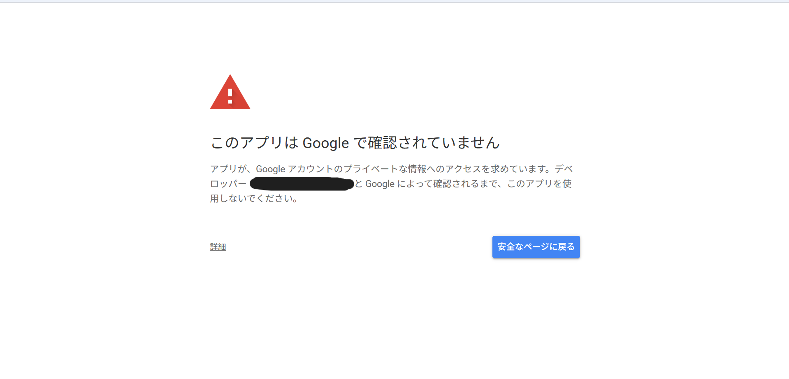
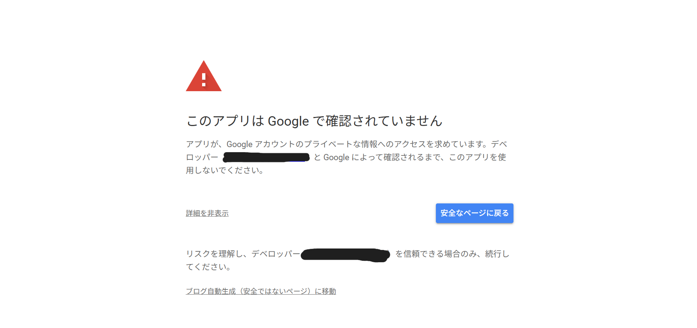
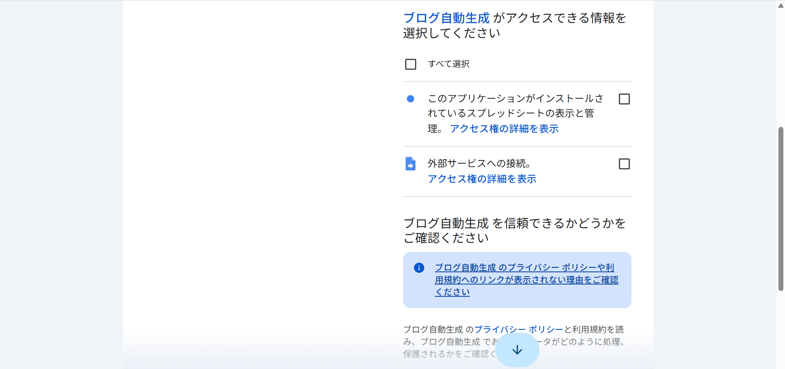
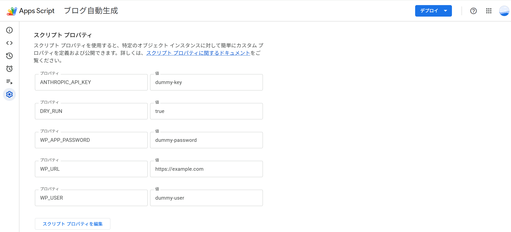

# 初期設定手順書

最初に1回だけ行う設定です。上から順番に進めてください。

## 1. スプレッドシートを自分のGoogleアカウントにコピーする

1. 納品されたスプレッドシートを開く
2. メニュー「ファイル」→「コピーを作成」を選択する
3. 保存先を自分(またはクライアント)のGoogleアカウントのマイドライブに指定して保存する

<!-- 画像:スプレッドシートのコピー手順 -->

以降の設定は、コピーした後の「自分のスプレッドシート」側で行ってください。

## 2. 初回の権限許可

コピーしたスプレッドシートでメニュー「記事生成」のいずれかの項目を初めて実行すると、
Googleから権限の確認画面が表示されます。表示される内容は次の2つです。

- このスプレッドシートの表示と管理
- 外部サービスへの接続(Claude API・WordPressと通信するために必要)

内容を確認し、「許可」を選択してください。

## 3. Anthropic コンソールでAPIキーを発行し、Script Propertiesに登録する

1. Anthropicのコンソール(Anthropicの公式サイトの管理画面)にログインする
2. APIキーの発行ページで、このツール専用の新しいAPIキーを作成する
   - キーは作成した画面で一度だけ表示されます。画面を閉じる前に、必ず次の手順でコピーして登録してください
   - 表示される値は「Anthropicのコンソールに表示される長い文字列」です。見た目の形式はここには記載しません
3. スプレッドシートのメニュー「拡張機能」→「Apps Script」を開く
4. 左側メニューの歯車アイコン(プロジェクトの設定)を選択する
5. 下部の「スクリプト プロパティ」→「スクリプト プロパティを追加」で、次を登録する

   | プロパティ名 | 値 |
   | --- | --- |
   | `ANTHROPIC_API_KEY` | 手順2で発行したAPIキー |

**注意:** APIキーは、このスクリプトプロパティ以外の場所(コード・シートのセル・チャットなど)には絶対に貼り付けないでください。

## 4. WordPress側の準備とスクリプトプロパティの設定

### 4-1. WordPress側の準備

1. WordPressの管理画面で、このツール専用のユーザーを新規作成する
   - 権限(役割)は「投稿者」にする(管理者権限は与えない)
2. 作成したユーザーでログインし、プロフィール画面の「アプリケーションパスワード」からパスワードを発行する
   - 名前(任意の識別名、例: `blog-auto-gas`)を入力して「新規追加」する
   - 発行されたパスワードも一度だけ表示されます。閉じる前に次の手順で登録してください

<!-- 画像:WordPressのアプリケーションパスワード発行画面 -->

### 4-2. スクリプトプロパティの設定

Apps Scriptエディタの「スクリプト プロパティ」に、以下を追加する。

| プロパティ名 | 値 |
| --- | --- |
| `WP_URL` | WordPressサイトのURL(`https://` から始まるもの。例: `https://example.com`) |
| `WP_USER` | 手順4-1で作成した専用ユーザーのユーザー名 |
| `WP_APP_PASSWORD` | 手順4-1で発行したアプリケーションパスワード |
| `DRY_RUN` | 試運転にするか本番投稿にするかの設定(次の項目で説明) |

## 5. DRY_RUN(試運転モード)について

`DRY_RUN` は、WordPressへ実際に送信するかどうかを切り替える設定です。

- `DRY_RUN` が未設定、または `false` 以外の値(例: `true`)の場合 → **試運転**になります。実際には何も送信せず、送信予定の内容(タイトル・文字数など)だけダイアログに表示します。
- `DRY_RUN` に `false` という文字列を**明記した**場合のみ → **本番投稿**になります。実際にWordPressへ下書きを作成します。

初めて使うときや、WordPressサイトをまだ用意していないときは、`DRY_RUN` を設定しない、または `true` にしておいてください。本番投稿に切り替えるときだけ、値を `false` に変更してください。

## 6. 「設定を確認」メニューでの確認方法

メニュー「記事生成」→「設定を確認」を実行すると、次の5つのプロパティが設定されているかどうかが、○(設定済み)/×(未設定)で表示されます。値そのものは表示されません。

- `ANTHROPIC_API_KEY`
- `WP_URL`
- `WP_USER`
- `WP_APP_PASSWORD`
- `DRY_RUN`

<!-- 画像:設定を確認メニューの実行結果ダイアログ -->

すべて○になっていることを確認してから、実際の記事生成・下書き保存を行ってください。

## 注意事項

- APIキー・パスワードは、**スクリプトプロパティ以外のどこにも書かないでください**(コードのセル、シートの値、メール、チャットなど)。
- スプレッドシートやコードを他の人と共有する場合も、スクリプトプロパティの値は共有先には表示されません(値自体はプロジェクトの設定内に保存されます)が、共有範囲は必要最小限にしてください。
