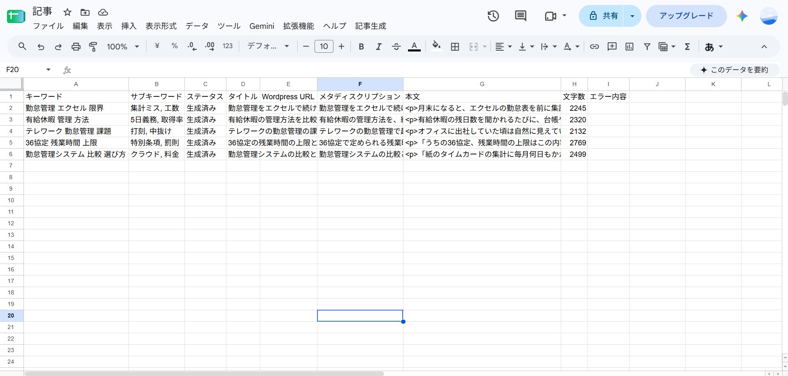
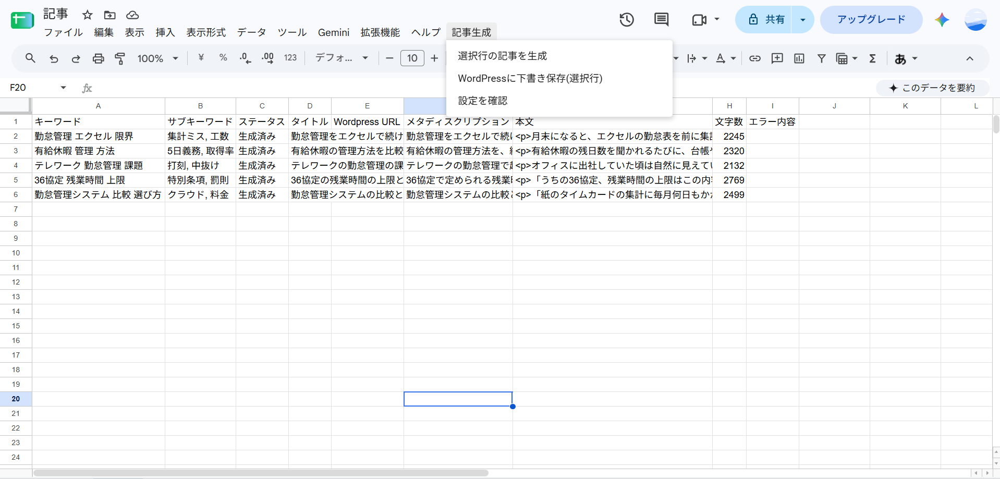
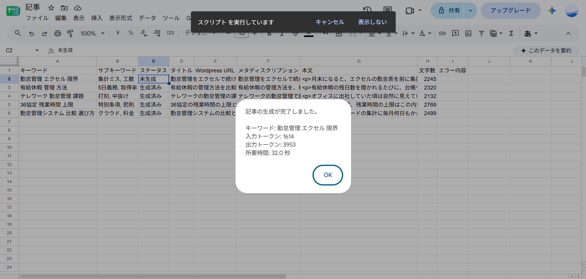
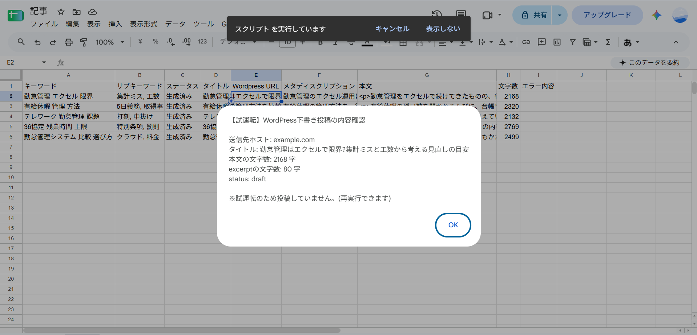

# 使い方(日々の操作)

初期設定(docs/setup-guide.md)が完了している前提の、日常的な使い方です。

## サンプル記事シートの役割

シート「サンプル記事」のセルA1には、文体・トーンの見本となる記事の本文を貼り付けておきます。

- このサンプルは「書き方の雰囲気」の参考としてのみ使われ、内容や表現がそのまま生成記事に転用されることはない指示になっています。
- セルA1が空、またはシート「サンプル記事」が存在しない場合、記事生成はエラーになり実行できません。

## 基本の流れ(1行ずつ実行する)

この操作は常に「選択している1行」にだけ行われます。複数行をまとめて処理することはできません。

1. シート「記事」で、キーワード(A列)・サブキーワード(B列、省略可)を入力した行を**1行選択する**

   

2. メニュー「記事生成」→「選択行の記事を生成」を実行する

   

3. 完了すると、タイトル(D列)・メタディスクリプション(F列)・本文(G列)・文字数(H列)が入り、ステータス(C列)が「生成済み」になる

   

4. **内容を必ず人が確認する**(タイトル・本文・文字数・不自然な表現がないかなど)
5. 問題なければ、同じ行を選択したまま、メニュー「記事生成」→「WordPressに下書き保存(選択行)」を実行する
6. 試運転(DRY_RUN)の場合は確認ダイアログが出るだけで、実際の投稿はされない。本番投稿(DRY_RUN=`false`)の場合は、WordPress投稿ID(J列)とURL(E列、取得できた場合)が入り、ステータスが「下書き保存済み」になる

   

## ステータス(C列)の意味

| ステータス | 意味 |
| --- | --- |
| 未生成 | まだ記事を生成していない状態 |
| 生成中 | 記事生成の処理が進行中(通常は数十秒で「生成済み」か「エラー」に変わる) |
| 生成済み | 記事生成が完了し、内容がバリデーション(文字数などのチェック)を通過した状態。WordPress下書き保存が可能 |
| 下書き保存済み | WordPressへの下書き保存が成功した状態 |
| 投稿済み | 将来、WordPress上で正式に公開した場合に使う想定のステータス(現時点のツールでは自動的にこの状態にはなりません) |
| エラー | 記事生成またはWordPress下書き保存に失敗した状態。エラー欄(I列)に原因が表示される |

**重複実行の防止:** ステータスが「生成中」「生成済み」「投稿済み」のときに「選択行の記事を生成」を実行しても、何も起こりません(上書きを防ぐため)。やり直したい場合は、いったんC列を「未生成」に戻してから再実行してください。

**WordPress下書き保存の実行条件:** ステータスが「生成済み」のとき、かつWordPress投稿ID(J列)が空のときだけ実行できます。J列に値が入っている行は、二重投稿防止のため実行できません。

## 生成後は必ず人が確認する

記事生成が完了しても、内容は自動でWordPressに送られません。次の点を人の目で確認してから、下書き保存を行ってください。

- タイトルがキーワードの意図と合っているか
- 本文に不自然な表現、事実と異なりそうな記述がないか
- 文字数(H列)が極端に短い・長い印象を与えないか

## 下書き保存の手順

1. ステータスが「生成済み」の行を選択する
2. メニュー「記事生成」→「WordPressに下書き保存(選択行)」を実行する
3. 試運転(DRY_RUN)の場合: 送信予定の内容(送信先ホスト名・タイトル・本文の文字数・excerptの文字数・status)がダイアログに表示されるだけで、実際には何も送信されない。シートの内容・ステータスは変わらないため、何度でも再実行できる
4. 本番投稿(DRY_RUN=`false`)の場合: 実際にWordPressへ下書きが作成される。成功するとWordPress投稿ID(J列)・URL(E列)が入り、ステータスが「下書き保存済み」になる

## 再送したいときの手順

### 記事生成でエラーになった場合

1. エラー欄(I列)の内容を確認する(文字数が範囲外、JSON解析失敗など)
2. 必要であればキーワード・サブキーワードを見直す
3. ステータス(C列)を「未生成」に戻す
4. 「選択行の記事を生成」を再実行する

### WordPress下書き保存でエラーになった場合

1. エラー欄(I列)の内容を確認する(docs/troubleshooting.md を参照)
2. 原因(設定・権限など)を解消する
3. WordPress投稿ID(J列)が**空のままであること**を確認する(空であれば再実行可能。値が入っている場合は、WordPress側で実際に下書きが作られているため、重複作成を避けるためWordPress側を直接確認してください)
4. 「WordPressに下書き保存(選択行)」を再実行する

### 試運転から本番投稿に切り替えたい場合

1. 試運転の内容確認で問題がないことを確認する
2. スクリプトプロパティ `DRY_RUN` を `false` に変更する(docs/setup-guide.md 参照)
3. 同じ行で「WordPressに下書き保存(選択行)」を再実行する
